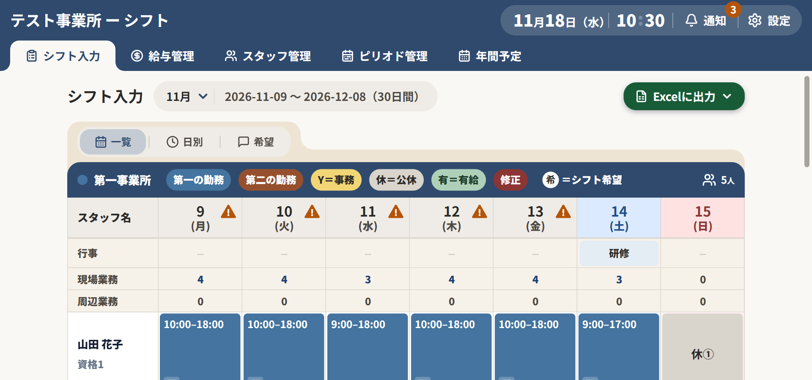
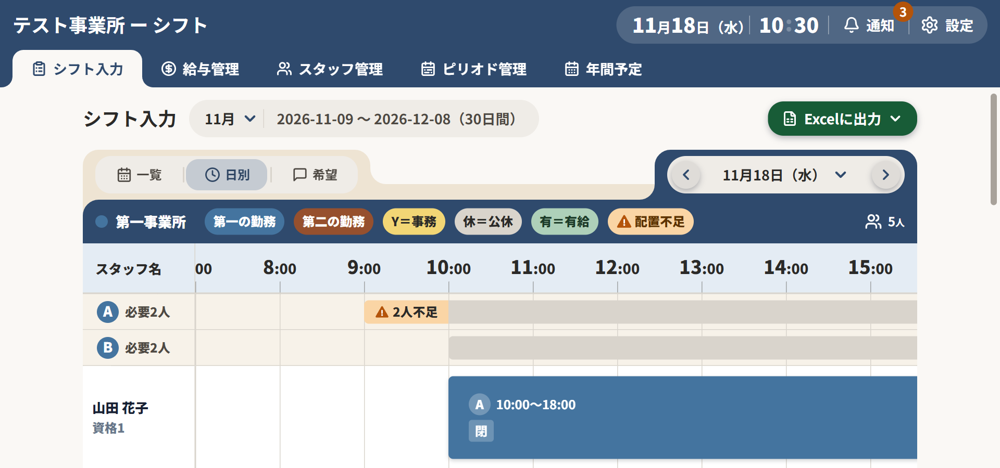
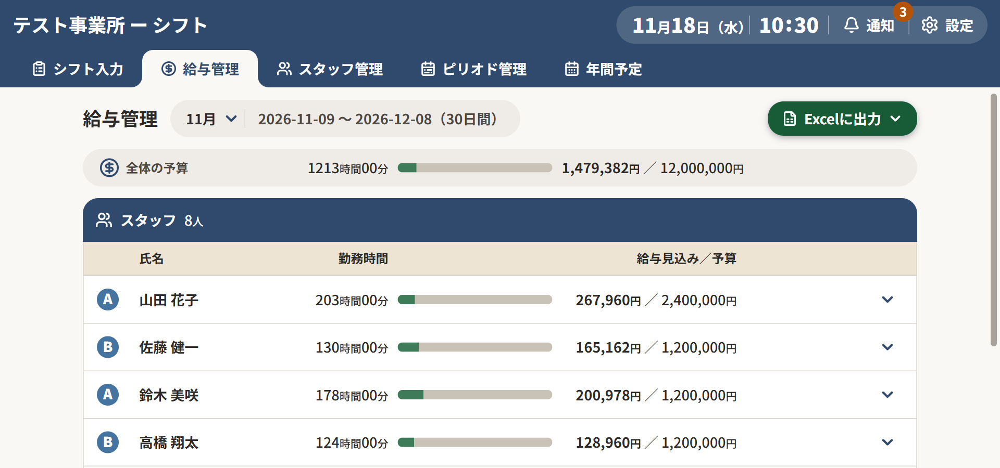
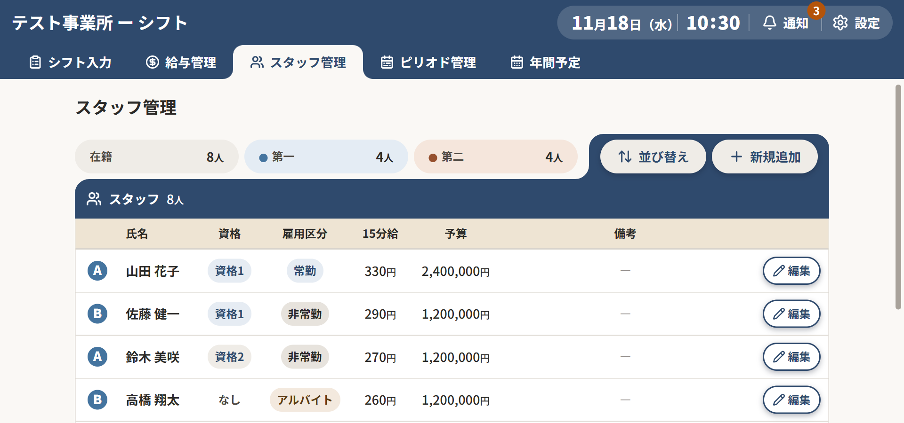
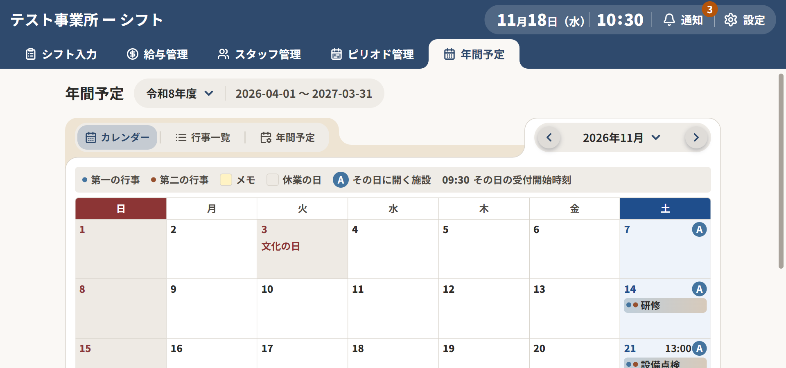
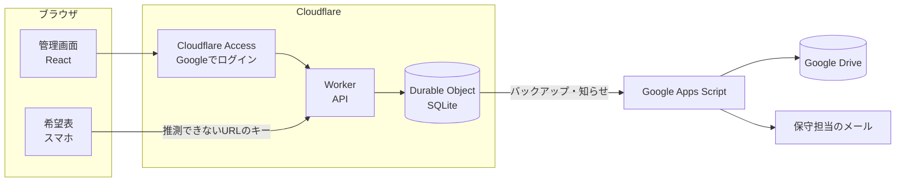

# shift-showcase

小規模の職場で扱うシフト管理アプリです。ブラウザからシフトの作成、行事や予定の管理、給与管理を行います。現場での使い方に合わせてExcelとして出力したり、さらにそれを紙として印刷したりして使います。スタッフはスマホからシフト希望を提出することができます。

実際に運用しているアプリとは別に、ポートフォリオ用として載せています。

## 画面

| シフト入力（一覧） | シフト入力（日別） |
|---|---|
|  |  |
| 給与管理 | スタッフ管理 |
|  |  |
| 年間予定 | |
|  | |

- **シフト入力**：2つの事業所に対応し、シフトを1月単位、1日単位で確認しながら編集することができます。人数の不足や、業務をこなす上で必要な役割を担う人が設定されていないと、通知で把握することができます。
- **給与管理**：シフトから勤務時間と見込みの給与を計算し、職場全体、個人の支出を管理できます。
- **スタッフ管理**：働くスタッフの契約形態や時給、資格の有無などを管理できます。
- **年間予定**：スケジュールを管理することができます。シフトの入力や、営業時間の計算にも用いります。

## 全体の構成



| 部分 | 中身 |
|---|---|
| 画面 | React 19、Vite。管理画面と希望入力画面を1つのビルドから映します |
| API | Cloudflare Workers。入口でCloudflare AccessのJWTを `jose` で検証し、アドレスを用いて役割や担当者を認証します |
| データ | 1つのDurable ObjectのSQLiteに、すべてのデータを持ちます。表の形の変更は `server/migrations/` の番号順に当てます |
| バックアップ | Durable Objectの目覚まし（alarm）で毎晩3時に確かめ、前回のバックアップの後にデータが変わっていれば、全データをgzipにしてGASへ送り、Google Driveに保存します。2晩続けて失敗すると、保守担当にメールで知らせます |
| 復元 | 時間を指定してデータを戻す仕組みを使うためのコマンドを使います |
| 公開 | 指定したコマンドで公開します。GithubのCIを通じてテストし、問題がなければ公開します。このときにバージョンを管理するための情報を記録します |

### 保存の作り

画面からの保存は、すべて1つの入口 `POST /api/save` を通します。

- **操作の名前と形**：保存は、`staff.save` や `shift.bulk.save` のような操作の名前と、データの形（`shared/save-shapes.ts`）を持ちます。形式がマッチしないと、中身を確かめずに弾きます。
- **同時の編集**：保存する行ごとに、そのときの状態に番号を振って送ります。ほかの人が先に変えていたら保存せず、今の値を返して画面上で通知します。
- **二重の送信**：保存ごとに操作のIDを付け、受け取った結果を保存します。途中で失敗して同じ内容を保存しようとしても、重複しないようにしています。
- **入力の保護**：送信前の入力は、ブラウザ（IndexedDB）に下書きとして保持します。保存の途中で画面を閉じても、次に開いたときに送り直すことができます。

## フォルダ

| 場所 | 中身 |
|---|---|
| `frontend/` | 画面（React）。管理画面と、スタッフのシフト希望の一覧 |
| `server/` | Worker と Durable Object |
| `shared/` | 画面とサーバーの両方で使う計算と型（日付、給与、勤務人数のカウントなど） |
| `gas/` | バックアップとメールを受け取る Google Apps Script |
| `tests/` | テスト（Vitest。サーバーは `@cloudflare/vitest-plugin` で workerd の上の本物の Durable Object を通します） |
| `tools/release/` | 公開のコマンド |
| `tools/maintenance/` | 復元と、バックアップのファイルの読み込みのコマンド |
| `tools/structure/` | フォルダの持ち主とimportの送り先を確かめる検査 |

## 動かし方

Node.js 24 が必要です。

```sh
npm ci
cp .dev.vars.example .dev.vars
npm run dev
```

表示されたURLをブラウザで開きます。手元では、`.dev.vars` のアドレスと役割でログインしたものとして動きます。データは空から始まります。

検査は、GitHub Actions と同じ次のコマンドです。

```sh
npm run format:check
npm run structure
npm test
npm run typecheck
npm run build
```

### 含めていない物

- **シフト表のExcelのひな形**：職場の特定につながりうるので掲載していません。シフト表のExcelの出力は、`frontend/public/excel/shift_template.xlsx` にひな形を置いたときだけ動きます。給与のExcelは、ひな形なしで出力できます。
- **本番の設定**：`wrangler.jsonc` の `ACCESS_TEAM`、`ACCESS_AUDIENCE`、`ROLE_TABLE` と、公開のコマンド（`tools/release/`）の公開先の名前（`your-subdomain`）は仮の値です。
